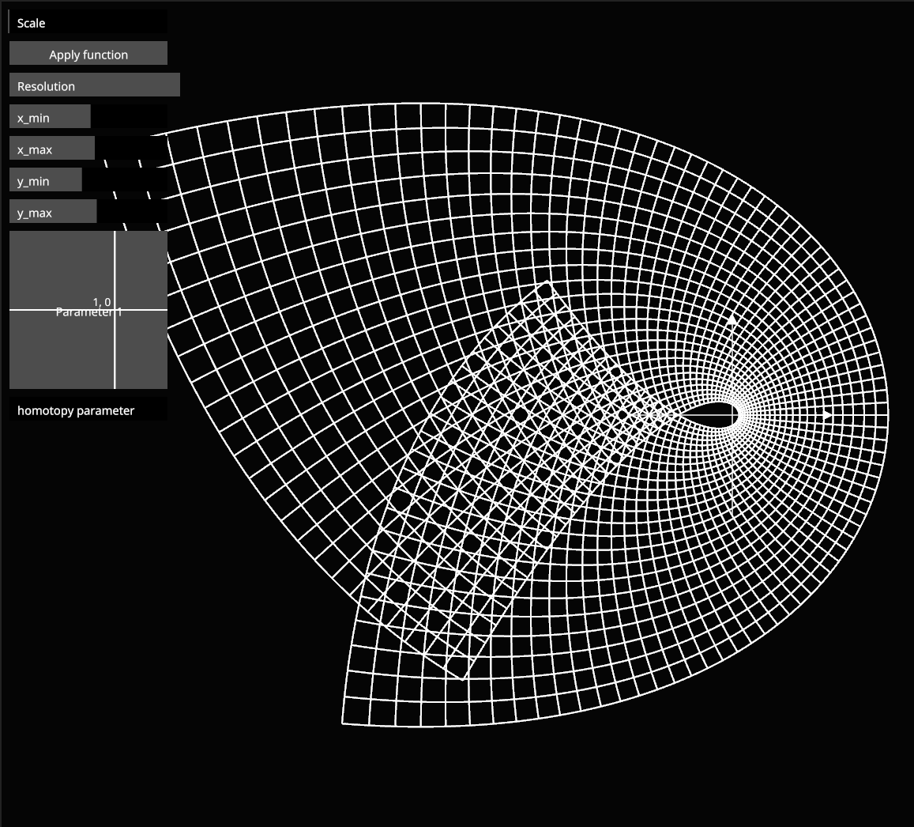
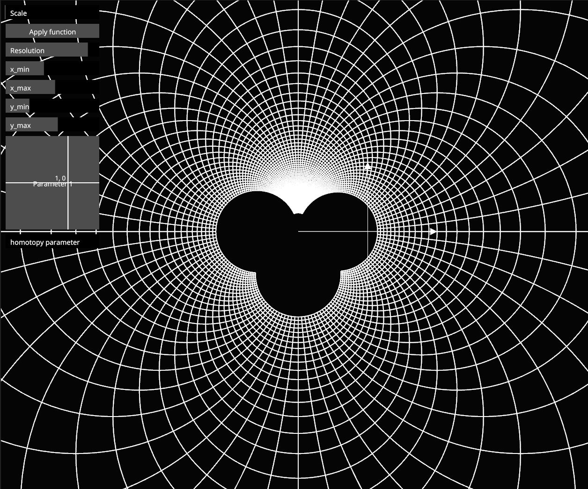

# Conformal Map Visualizer

Built with [nannou](https://nannou.cc) 0.20 (on Bevy) and its egui integration.

## Examples

The exponential function of course looks like this:


While z^3 looks like this shape when applied to a tall rectangle just right of 0:


This is a Möbius Transformation, in particular (1-z)/(1+z), but it should be called
a Mickey Mouse function, as every Möbius Transformation contains a Mickey Mouse 
(unproven Conjecture)



## Development

The dev environment is managed with [devenv](https://devenv.sh); enter it with
`devenv shell`. It provides the Rust toolchain, fontconfig for building, and the
runtime libraries (Vulkan/GL, Wayland, X11) the window needs.

The first build compiles Bevy (~590 crates), so expect a few minutes.

```sh
cargo run --release   # run the visualizer
cargo test            # unit tests (also: `devenv test`)
```

Inside the shell, cargo is limited to 90% of the CPU cores (`CARGO_BUILD_JOBS`).

### Nix package

The app is also exposed as a devenv output (built with crate2nix):

```sh
devenv build outputs.conformal-visualizer      # build locally
build-remote                                   # same, but only on remote builders (nixbuild.net)
```

Both print the store path. The binary is `<path>/bin/conformal-visualizer`.

## Usage
* The grid is mapped on the GPU: `src/grid.wgsl` evaluates the function for
  every point, so the grid can be dense. There is
  no function parser, so change `f` in that shader (and `FUNCTION_LABEL` at the
  top of `src/main.rs`):
  ```wgsl
  fn f(z: vec2<f32>, p: vec2<f32>) -> vec2<f32> {
      return cmul(cdiv(ONE - z, ONE + z), p);
  }
  ```
  Complex numbers are `vec2(re, im)`. Add and subtract with `+` and `-`; the
  shader provides `cmul`, `cdiv`, `cexp`, `clog`, `cpow`, `csin`, `ccos` and the
  constants `ONE` and `I`. `p` is the parameter set with the XY pad.
* Color modes (`c` cycles them, `1`–`5` pick one):
    * **White**: plain lines.
    * **Source**: horizontal lines warm, vertical lines cool, shaded by
      position, so you can follow each line of the grid to its image.
    * **Phase**: the hue of each point is the angle `arg z` of where it came
      from. Peek at the source grid (hold `x`) to see the color wheel, then let
      go to see where each color went.
    * **Stretch**: `|f'(z)|`, how much the map scales lengths near each point.
      Blue shrinks, grey keeps, orange grows.
    * **Rotation**: `arg f'(z)`, how far the map turns directions near each
      point, as a color wheel.

    A conformal map acts near each point like multiplying by `f'(z)`, so Stretch
    and Rotation together show everything the map does locally. The grid
    shows that right angles are kept.
* Controls. Most are a key held down while you scroll (mouse wheel or
  touchpad) or just move the mouse:
    * drag or scroll to pan, `shift + scroll` to zoom around the cursor, `h` to
      reset the view
    * `ctrl + scroll` to make the grid finer or coarser
    * hold `w` / `a` / `s` / `d` and scroll or move the mouse to drag the top /
      left / bottom / right edge of the grid. Hold two opposite ones (`a + d`,
      `w + s`) to slide the grid along, all four to move it
    * on a laptop touchpad, holding a letter key may switch the touchpad off
      (libinput's disable-while-typing). Press `ctrl` first, then the key:
      `ctrl + a + scroll` works the same, and the touchpad stays on. This goes
      for `p` and `f` below too
    * hold `p` and scroll or move the mouse, or right-drag the canvas, to move
      the parameter `p`; `r` resets it
    * hold `f` and scroll or move the mouse to blend from the identity to `f`
      (the homotopy)
    * `space` toggles applying the function; hold `x` or the "Hold to show
      source" button to peek at the source grid
    * the control window has sliders for everything, with these shortcuts
      written underneath
