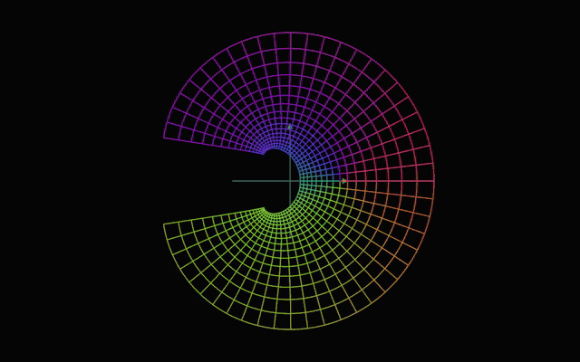
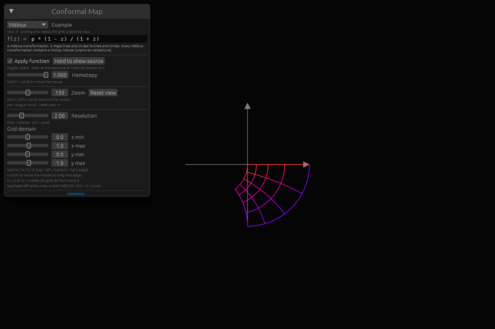
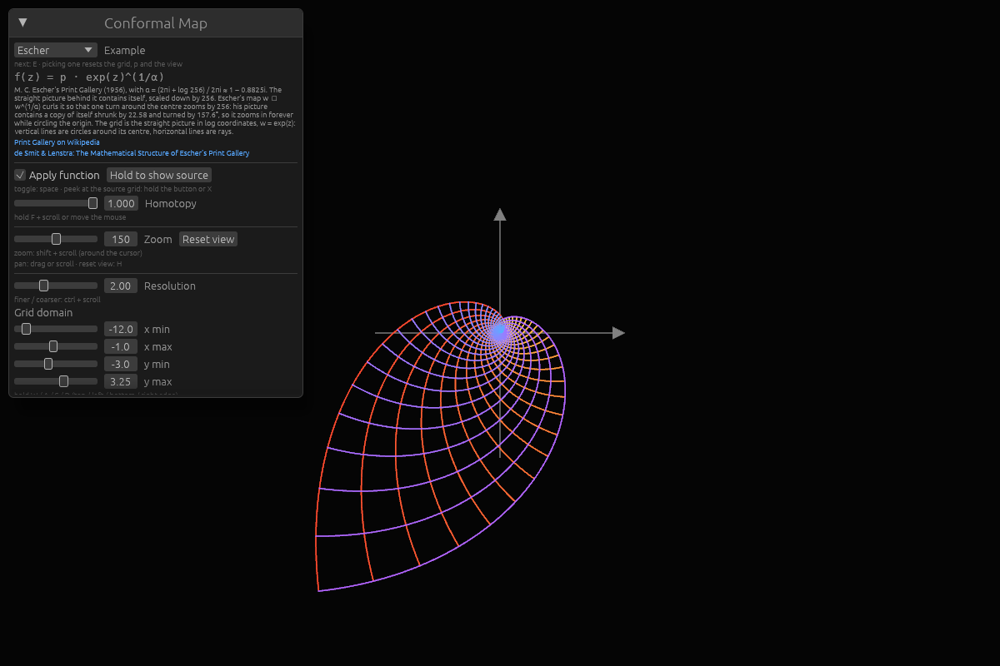
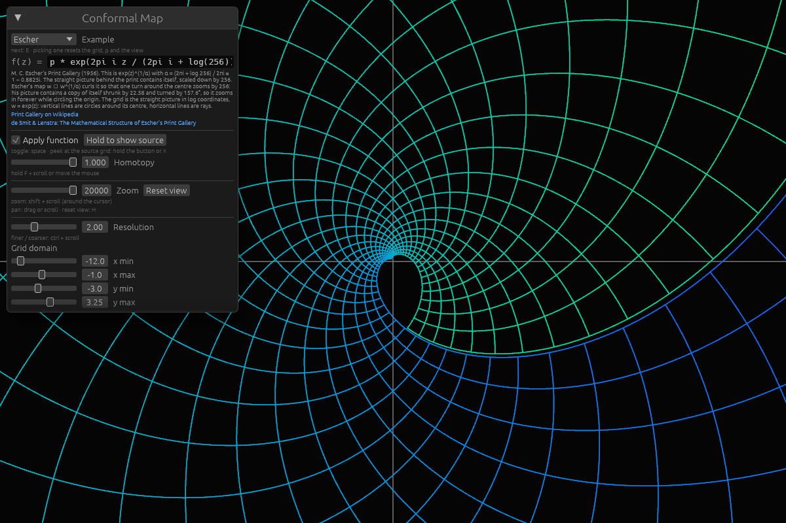
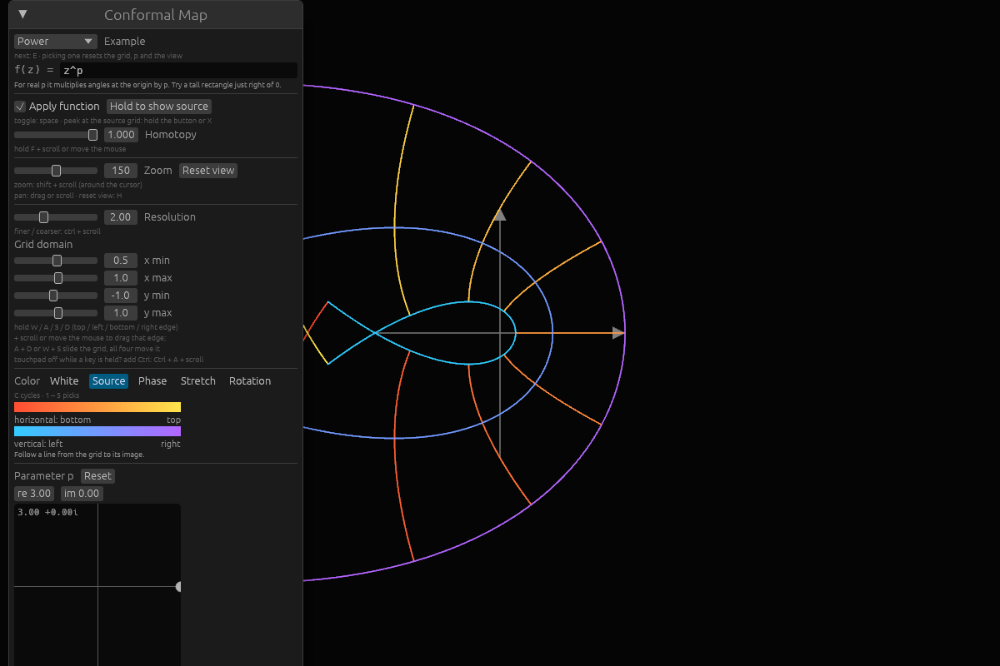
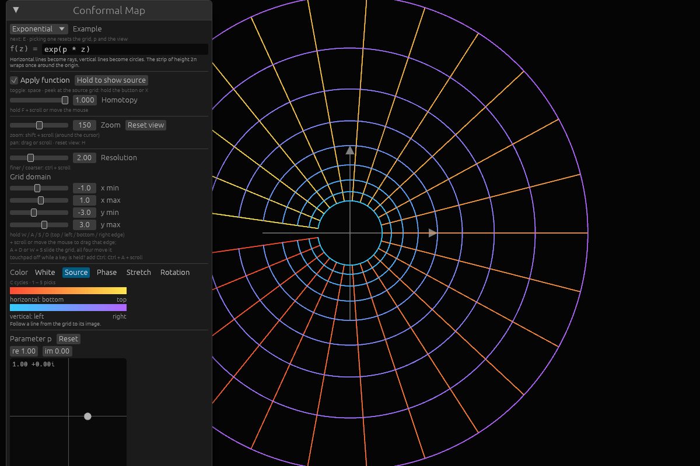
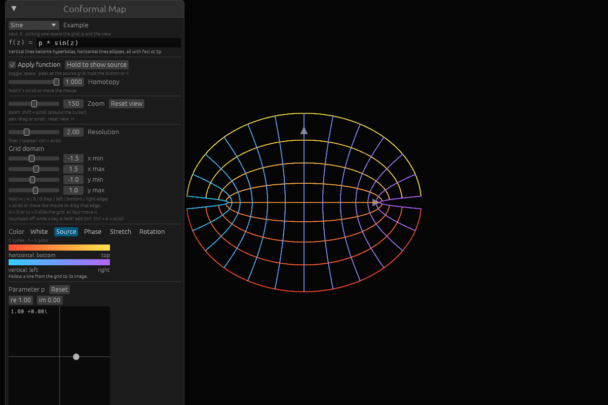
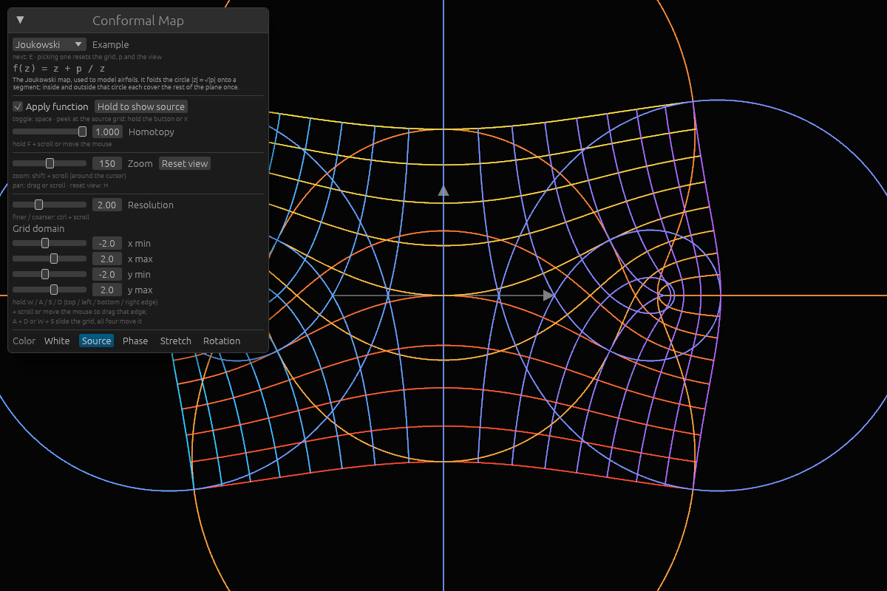

# Conformal Map Visualizer

**[Open it in your browser →](https://frederiksemmel.github.io/holomorphic-visualizer/)**



Type any complex function f(z) and watch it bend a grid of the plane, live on
the GPU, in the spirit of 3Blue1Brown's animations. Slide from the identity to
f, drag the parameter p around, and color the lines by where they came from,
by how much f stretches them, or by how far it turns them. Take a composition
like sin(cos(p · z)) apart and watch it built up one layer at a time.

The URL always holds what you're looking at, so you can share a view by
sharing the link (there's also a **Copy link** button). For example:
[Escher's Print Gallery](https://frederiksemmel.github.io/holomorphic-visualizer/#ex=escher),
[exp(1/z) near its essential singularity](https://frederiksemmel.github.io/holomorphic-visualizer/#f=exp%281/z%29&grid=-1,1,-1,1&res=4&color=source&view=0,0,300),
[the Joukowski map stretching a disk](https://frederiksemmel.github.io/holomorphic-visualizer/#ex=joukowski&color=stretch).

It needs WebGPU: Chrome or Edge, Safari 26+, or Firefox 141+ on Windows. On
Linux, Chrome needs `chrome://flags/#enable-unsafe-webgpu`. Without it, run
the [desktop app](#development).

## Examples

Pick one from the **Example** menu in the control window, or press `e` to step
through them. Each brings its own grid and parameter, and fills in its formula,
which you can then edit (see [Usage](#usage)). The screenshots use the
default Phase coloring: every point keeps the hue of its angle arg z in
the source grid, so you can see where each direction went.

A Möbius transformation, p · (1 − z)/(1 + z), maps lines and circles to lines
and circles. Here it bends the unit square:



The coolest one is M. C. Escher's
[Print Gallery](https://en.wikipedia.org/wiki/Print_Gallery_(M._C._Escher))
(1956): a young man in a gallery looks at a print of a town that contains the
gallery he is standing in. De Smit and Lenstra worked out the math in
[The Mathematical Structure of Escher's Print Gallery](https://pub.math.leidenuniv.nl/~smitbde/papers/2003-de_smit-lenstra-escher.pdf)
(Notices of the AMS, 2003). Escher started from a straight picture that
contains itself, scaled down by 256, and curled it with

$$w \mapsto w^{1/\alpha}, \qquad \alpha = \frac{2\pi i + \log 256}{2\pi i} \approx 1 - 0.8825i,$$

so that one turn around the centre zooms in by 256. His picture contains a copy
of itself shrunk by 22.58 and turned by 157.6°, so it zooms in forever while
circling the origin. The grid here is the straight picture in log coordinates,
w = exp(z): vertical lines are circles around its centre, horizontal lines are
rays. The map draws them the way Escher curled them.

The example zooms by e⁶ ≈ 403 per turn instead of 256:

$$f(z) = \exp\left(\frac{2\pi i\, z}{2\pi i + \log(p\, e^6)}\right), \qquad p = 1.$$

f repeats itself after z moves by 2πi + log(p e⁶), so a circle that leaves one
turn comes back log(p e⁶) further in. With p = 1 that is exactly 6, a whole
number of grid spacings at every resolution, so each circle meets up with
another one. Escher's 256 is p = 256/e⁶ ≈ 0.635, where log 256 ≈ 5.545 and
the circles miss each other.



Zoom in on the centre (`ctrl + scroll`) and the spiral keeps going:



z³ applied to a tall rectangle just right of 0 (the Power example, z^p with
p = 3) wraps the band around the origin:



The others: exp(p · z), p · sin z and the Joukowski map z + p / z.





## Development

Built with [nannou](https://nannou.cc) 0.20 (on Bevy) and its egui integration.
The dev environment is managed with [devenv](https://devenv.sh); enter it with
`devenv shell`. It provides the Rust toolchain, fontconfig for building, and the
runtime libraries (Vulkan/GL, Wayland, X11) the window needs.

The first build compiles Bevy (~590 crates), so expect a few minutes.

```sh
cargo run --release   # run the visualizer
cargo test            # unit tests (also: `devenv test`)
```

The desktop app takes a link, or just its `#…` part, as its argument:
`cargo run --release -- '#ex=escher&color=source'`. Its **Copy link** button
copies a link to the browser version.

Inside the shell, cargo is limited to 90% of the CPU cores (`CARGO_BUILD_JOBS`).

### Web

```sh
build-web    # build the browser version into web/dist
serve-web    # build it and serve it on http://127.0.0.1:8080
```

To try changes in the browser, run `devenv up`. It rebuilds the fast `web-dev`
profile whenever a source file changes and serves it through Tailscale funnel
on https://beast.cuscus-exponential.ts.net:10000/ until you stop it. Reload the
page once `web-build` has finished.

The release build optimizes the whole program as one unit and then runs
wasm-opt, which takes minutes even after a small change. For trying it out,
`WEB_PROFILE=web-dev` (in nushell: `with-env {WEB_PROFILE: web-dev} { serve-web }`)
builds in seconds after the first time, for a bigger download.

WebGPU needs a secure context, so a phone on the same Wi-Fi gets the fallback
page from `http://<laptop>:8080`. With Tailscale on both, `tailscale serve --bg
8080` serves it over HTTPS on the tailnet.

CI (`.github/workflows/web.yml`) builds it for every pull request and publishes
it to GitHub Pages from `master`. nannou is vendored in `vendor/nannou` with
fixes for the web build; see the note in `Cargo.toml`.

The axis numbers and the hover readout are set in two of
[KaTeX](https://katex.org)'s fonts, in `assets/fonts` with their license
(SIL Open Font License 1.1); the control window keeps egui's own font.

### Nix package

The app is also exposed as a devenv output (built with crate2nix):

```sh
devenv build outputs.conformal-visualizer      # build locally
build-remote                                   # same, but only on remote builders (nixbuild.net)
```

Both print the store path. The binary is `<path>/bin/conformal-visualizer`.

## Usage
* Type any function into the `f(z) =` field, for example `z^2 + p`,
  `p sin(z) / z` or `exp(1/z)`. The picture follows as you type; while a
  formula has an error, the message says where and the last working one stays
  on screen. `Esc` goes back to the example.
    * `z` is the point, `p` the parameter set with the XY pad, plus `i`, `pi`
      (or `π`) and `e`.
    * `+ - * / ^` with the usual precedence; `^` binds tightest, to the right.
      Writing things next to each other multiplies: `2pi i z`, `p sin(z)`.
    * Functions, with parentheses: `exp`, `log` (or `ln`), `sqrt`, `sin`,
      `cos`, `tan`, `sinh`, `cosh`, `tanh`. `log`, `sqrt` and non-integer
      powers use the principal branch, cut along the negative real axis.
      Integer powers like `z^3` or `z^-2` are multiplied out and have no cut.
* Dynamic function eval: the grid is mapped on the GPU. `src/expr.rs` parses
  the formula and translates it into WGSL (`p sin(z)` becomes
  `cmul(p, csin(z))`), and the app rebuilds the grid shader from
  `src/grid.wgsl`, the complex helpers in `src/complex.wgsl` and the generated
  `f` (with the stage before it, for a stage), which Bevy recompiles. Only
  formulas that parse are sent to the GPU,
  and the tests compile the code generated for a range of formulas with naga.
  The CPU evaluates the same parse tree, with the same branch cuts, only for
  the few points the mouse needs, such as which grid border is under it or
  what landed under the cursor.
* Stages take a function apart into the steps it is composed of. The app reads
  them off the formula: `sin(cos(p * z))` has the stages `z`, `p·z`,
  `cos(p·z)` and `sin(cos(p·z))`. Keys `1` to `9` pick a stage and `0` goes back
  to the full function. The control window has a button for each, showing its
  formula, which also reaches stages past 9 and works on a phone.
    * Stage k shows its own step: the homotopy blends stage k − 1 into stage k.
      Picking a stage shows it finished, so scrubbing back reveals where it
      came from and Animate plays that step alone; if the animation is
      already playing, it goes on from the start of the new stage. Stage 1 is
      the identity, so there is nothing to blend. In the full function the
      homotopy goes from the identity to f, start to finish.
    * The formula is walked from the outside in, for as long as exactly one
      operand of a step depends on z. Constants and `p` belong to their step,
      so `p * z` is one stage. When several operands depend on z, that step
      stays one stage: `exp(z + 1/z)` has the stages `z`, `z + 1/z` and
      `exp(z + 1/z)`, and the Möbius example has just two.
    * The hover readout (`g3(z)` is stage 3), the colors and the mouse all
      follow the stage. Stretch and Rotation show the composition up to the
      stage, not its last step alone. Editing the formula or picking an example
      goes back to the full function.
* Color modes (`c` cycles them, or pick one in the control window):
    * **White**: plain lines.
    * **Source**: horizontal lines warm, vertical lines cool, shaded by
      position, so you can follow each line of the grid to its image.
    * **Phase** (the default): the hue of each point is the angle `arg z` of
      where it came from. Peek at the source grid (hold `x`) to see the color wheel, then let
      go to see where each color went.
    * **Stretch**: `|f'(z)|`, how much the map scales lengths near each point.
      Blue shrinks, grey keeps, orange grows.
    * **Rotation**: `arg f'(z)`, how far the map turns directions near each
      point, as a color wheel.

    A conformal map acts near each point like multiplying by `f'(z)`, so Stretch
    and Rotation together show everything the map does locally. The grid
    shows that right angles are kept.
* Behind the grid, a faint grid of the plane itself, numbered along the axes,
  refines and coarsens as you zoom (steps of 1, 2 or 5 times a power of
  ten). When an axis is off screen, its numbers stay at the edge of the
  window.
* Rest the cursor on the canvas for half a second to see what landed under
  it: the point w there and the grid points z that the map sends to w (up to
  three; the Joukowski map has two), with how much f stretches and turns
  near each, `|f'(z)|` and `arg f'(z)`. Dots mark w and each z, joined by a
  line. The CPU finds the z by Newton's method, seeded from a coarse sample
  of the grid. Moving, scrolling or holding a key or button hides it.
* Controls. Most are a mouse drag, a scroll (mouse wheel or touchpad) with a
  modifier, or a key held down while you scroll or just move the mouse:
    * drag or scroll to pan, `ctrl + scroll` to zoom around the cursor, `h` to
      reset the view
    * `shift + scroll` or `shift` + drag moves a border of the grid, wherever
      the map has put it: the one drawn nearest the cursor when `shift` goes
      down, until you let go. Only the part of the motion across the border
      counts: a drag moves it as fast as the mouse, a scroll by grid squares
    * `alt + scroll` or `alt` + drag slides the source grid: the square itself
      moves, and the map draws its image wherever that lands
    * `ctrl + shift + scroll` or `ctrl + shift` + drag makes the grid finer
      or coarser
    * hold `w` / `a` / `s` / `d` and scroll or move the mouse to drag the top /
      left / bottom / right edge of the grid. Hold two opposite ones (`a + d`,
      `w + s`) to slide the grid along, all four to move it
    * on a laptop touchpad, holding a letter key or `space` may switch the
      touchpad off (libinput's disable-while-typing). Press `ctrl` first, then
      the key: `ctrl + a + scroll` and `ctrl + space` work the same, and the
      touchpad stays on. This goes for `p` and `f` below too
    * hold `p` and scroll or move the mouse, or right-drag the canvas, to move
      the parameter `p`; `r` resets it to the example's value. Dragging it on
      its pad in the panel or with the right button, `shift` moves it 5×
      finer
    * blend from the identity to `f`, or through a stage (the homotopy), with
      `←` / `→`, `space + scroll`, or holding `f` and scrolling or moving the
      mouse
    * `space` (or `m`, or the Animate box) plays the blend back and forth, as
      it does when the visualizer opens or you pick an example, and pauses it;
      taking the homotopy in hand stops it too
    * **Copy link** copies a link to exactly this view. The page URL always
      shows it as well: the example, the formula, `p`, the grid, the coloring,
      the view, the stage and the homotopy, written as what differs from the
      example.
      Editing the `#…` part of the URL by hand works too
    * `e` steps to the next example
    * hold `x` or the "Hold to show source" button to peek at the source grid
    * the control window has sliders for everything, with these shortcuts
      written underneath
